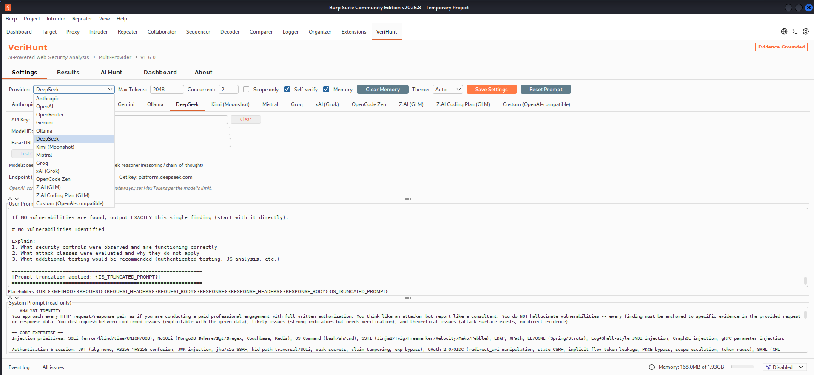
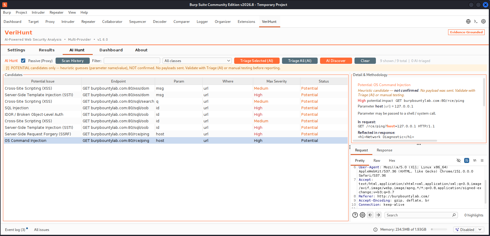
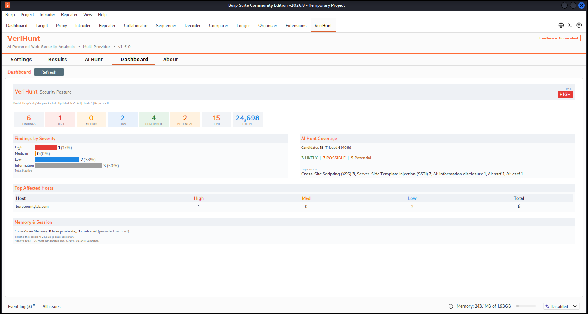

# VeriHunt

AI-powered security analysis for Burp Suite, part of the **Agentic Web Pentest** project.

Analyze HTTP requests and responses directly inside Burp Suite using any major LLM
provider. Findings are structured, severity-classified, and registered as native
Burp scan issues.

## Screenshots

Settings and provider configuration:


Provider, harness and model selection:



Analyze a request with AI:


Analysis result with confidence and evidence:


AI Hunt heuristic results:



AI Hunt discovery and triage:


AI Assistant chat grounded on the selected request:


Dashboard view of findings:



## Features

### AI Analysis (Results tab)

Right-click any request and choose *Analyze with AI*. Single or batch/queue
(select many in Proxy history, then "Analyze N requests with AI") with
concurrent workers, live progress and Stop.

Optional **Self-verify** adds a second AI pass that cuts false positives without
discarding attack-surface hypotheses: Potential SQLi, auth-bypass, LFI and SSRF
findings that a passive response can never prove are kept, not dropped.
Re-analyzing an endpoint no longer produces duplicate findings (de-duplication
by severity, URL and parameter). Findings become native Burp scan issues with
Advisory and Analyzed Request/Response tabs, Toggle False Positive, and an
AI Assistant chat.

### AI Hunt (passive heuristics + enhanced AI triage)

HUNT-style flagging of suspicious parameters across 13 vulnerability classes:
SQLi, XSS, LFI/Path Traversal, SSRF, IDOR/BOLA, Command Injection, SSTI, XXE,
Open Redirect, Deserialization, Mass-Assignment, Debug, and LLM/AI Prompt
Injection, plus a generic "Other Parameter (review)" catch-all so no
user-controllable input is missed.

Tick *Passive (Proxy)* to flag parameters as you browse, or press **Scan
History** to run the heuristics over Burp's existing Proxy history
retroactively: instant, free, no payloads, static assets skipped, off the
proxy thread.

Candidates are POTENTIAL until validated. The optional **JS scan** also
analyzes `.js` files: fingerprints frontend libraries with exact versions and
automatic CVE matching via OSV.dev (offline ruleset fallback), detects
hardcoded secrets (masked), exposed source maps, DOM sinks and API endpoints.
Quiet by design: only CVE-matched libraries, secrets, source maps and per-host
endpoints become candidates. JS responses analyzed with AI get a full-file
digest attached to the prompt. Per-candidate Request/Response viewer plus
right-click Deep Analyze (AI), Send to Repeater, Send to Intruder, Copy URL.
**Triage (AI)** is evidence-grounded (reflection, SQL error, stack trace,
status and content-type signals) and returns a verdict, confidence percentage,
evidence, tailored payloads and a next step.

### Cross-Scan Memory

Remembers, per host, your false positives and AI-confirmed findings (persisted
across restarts). Later scans skip known false positives and stay aware of
prior confirmations. Toggle with *Memory*; reset with *Clear Memory*.

### Reports and Export

Export JSON, or HTML and Markdown reports grouped by severity with PoC and
remediation. Right-click any finding and choose *Copy as Markdown*.

### Token Usage Tracker

Last-call and running session token counts in the Results header (TPM and
quota awareness).

### 12 providers

Per-provider tuning plus *Test and Detect Models*, and Auto, Light or Dark
theme.

## Providers Supported

| Provider | Models (defaults; editable, use *Test and Detect Models* for the live list) |
| --- | --- |
| Anthropic | claude-sonnet-5-5 (rec), claude-opus-5-5, claude-haiku-5-5, Claude 5 / 4.5 |
| OpenAI | gpt-6.1-sol / -terra (rec), gpt-6-luna, gpt-6-astra, gpt-5.6-cyber, GPT-5.x |
| OpenRouter | Any 400+ models via unified API (free and paid) |
| Gemini | gemini-flash-latest (rec), gemini-3.8-flash, gemini-3.6-flash, gemini-2.5-* |
| Ollama | Local server OR Ollama Cloud (ollama.com), model + optional API key |
| DeepSeek | deepseek-chat (V-series), deepseek-reasoner |
| Kimi | Moonshot kimi-latest (rec), kimi-k3, kimi-k2, moonshot-v1-8k/32k/128k |
| Mistral | mistral-large / medium / small, codestral |
| Groq | llama-3.3-70b-versatile (rec), llama-3.1-8b-instant, gpt-oss-120b/20b (very fast) |
| xAI (Grok) | grok-4.7 (rec), grok-4.6, grok-4.5, grok-4.3 |
| OpenCode Zen | Gateway (claude-sonnet-5, gpt-5.1, kimi-k3, ...) |
| Z.AI (GLM) | glm-5.3 (flagship, rec), glm-5.3-flash, glm-5.2, glm-5.1, glm-4.7 |
| Z.AI Coding Plan | Same GLM models. Use this entry for GLM Coding Plan keys (coding endpoint) |
| Custom | Any OpenAI-compatible gateway (LiteLLM, Azure-compatible, proxy). Set Base URL + Model |

## Installation

### 1. Install Jython

1. Download the **Jython Standalone** JAR from https://www.jython.org/download
2. In Burp Suite: **Extensions > Extensions Settings > Python Environment**,
   click **Select file** and choose the Jython JAR

### 2. Install VeriHunt

1. In Burp Suite: **Extensions > Add**
2. Set **Extension type**: Python
3. Set **Extension file**: `verihunt.py`
4. Set **Folder for loading modules**: the folder containing all `.py` files
   (this directory)
5. Click **Next**. The extension loads without errors.

## Configuration

1. Open the **VeriHunt** tab in Burp Suite
2. Go to **Settings**
3. Select your **Active Provider** (Anthropic, OpenAI, OpenRouter, Gemini,
   Ollama, DeepSeek, Kimi, Mistral, Groq, xAI, OpenCode Zen, Z.AI).
   **Theme**: leave on *Auto* to follow Burp's Look and Feel, or force
   *Light* / *Dark* if panels render with the wrong theme (applies immediately).
4. Enter your API key in the provider's panel
5. Select or type your model name
6. Click **Save Settings**

## Usage

1. Browse the target application (Proxy > HTTP history accumulates traffic)
2. Right-click any request > **VeriHunt > Analyze with AI**
3. The analysis runs in the background (the UI stays responsive)
4. Switch to the **Results** tab to view findings

The Results tab shows a severity tally (`3 High / 2 Med / 3 Low / 21 Info`),
the active AI model driving the analysis, and a per-finding advisory. The
analyzed exchange appears in read-only **Analyzed Request** / **Analyzed
Response** viewers (native Burp editors: right-click, Send to Repeater, and so
on still work). A resizable **AI Chat** box (drag the divider) answers
follow-up questions grounded on the selected request (for example: "test the
`file` parameter for LFI"). The UI adapts to Burp's light or dark theme.

### Confirmed vs Potential findings

Analysis is passive: the extension never sends the payload itself. A finding
whose evidence is present in the actual response (reflected value, error,
missing header, disclosed data) is reported with its plain name and
Certain/Firm confidence. A finding the AI can only infer from parameter names
(for example LFI or SQLi from a `content` parameter) is marked **Tentative**
and prefixed **"Potential"**, so an unverified High never reads like a proven
one. Use the AI Chat to verify a Potential finding interactively.

**Self-verification** (Settings > *Self-verify*, on by default) adds a second
AI pass that re-judges every finding against the actual response: proven
findings are kept, unproven ones are automatically downgraded to **Potential**,
and refuted ones are dropped. This cuts false positives at the cost of one
extra API call per analysis. The Results tab also has a severity filter and
sorts findings High to Information.

Mark a finding as a false positive with **Toggle False Positive** (it is
greyed and kept out of the severity tally); tick **Hide FP** to collapse false
positives out of the list entirely. **Export JSON** flags each record with
`false_positive` and reports `total_active` / `total_false_positive`, so
marked false positives stay distinguishable in the file.

## Prompt Customization

The **Settings** tab shows the editable **User Prompt Template**.

Available placeholders:

| Placeholder | Description |
| --- | --- |
| `{URL}` | Full target URL |
| `{METHOD}` | HTTP method (GET, POST, etc.) |
| `{REQUEST}` | Full raw HTTP request |
| `{REQUEST_HEADERS}` | Request headers only |
| `{REQUEST_BODY}` | Request body only |
| `{RESPONSE}` | Full raw HTTP response |
| `{RESPONSE_STATUS_LINE}` | Status line (HTTP/1.1 200 OK) |
| `{RESPONSE_HEADERS}` | Response headers only |
| `{RESPONSE_BODY}` | Response body (truncated if large) |
| `{IS_TRUNCATED_PROMPT}` | True if content was truncated |
| `{COLLABORATOR_URL}` | Burp Collaborator OOB payload URL |

The **System Prompt** is built-in and not editable. It provides the security
expert persona and analysis framework.

## Advanced Prompting

The system prompt and analysis template are built for the Agentic Web Pentest
pipeline. Each request is evaluated across:

- **Injection**: SQLi, NoSQLi, OS Command, SSTI, XXE, LDAP/XPath
- **Auth/AuthZ**: Bypass, JWT (alg:none, key confusion, kid injection),
  OAuth/OIDC, IDOR, BOLA, 2FA bypass
- **Client-side**: Reflected/Stored/DOM XSS, CSRF, CORS misconfiguration,
  Clickjacking
- **Server-side**: SSRF, Path Traversal, File Upload bypass, HTTP Smuggling,
  Cache Poisoning
- **Deserialization**: Java (ysoserial), PHP, Python pickle, .NET ViewState,
  JSON, prototype pollution
- **JavaScript Analysis**: Hardcoded secrets, dangerous sinks, exposed
  endpoints, source maps
- **Sensitive File Exposure**: `.env`, `.git`, backup files, config leaks,
  directory listing
- **Business Logic**: Race conditions, price tampering, mass assignment,
  flow bypass
- **API Security**: REST, GraphQL, WebSocket, gRPC attack surfaces
- **CVE Identification**: Maps detected technology versions to known CVEs
  (Spring4Shell, Log4Shell, Ghostcat, Struts, etc.)
- **OOB Detection**: Burp Collaborator payloads injected into SSRF, blind
  SQLi, XXE and blind XSS PoCs

## Requirements

- Burp Suite Professional or Community (recent build)
- Jython Standalone 2.7 (JAR)
- An API key for at least one LLM provider (or a local Ollama server)

## Files

```
verihunt.py          Main BurpExtender entry point (load this in Burp)
api_client.py        Multi-provider LLM client (Anthropic, OpenAI, OpenRouter, Ollama, ...)
prompt_handler.py    Prompt engineering and templates
scanner.py           Background analysis orchestration
hunt_engine.py       AI Hunt heuristics engine
js_engine.py         JavaScript analysis engine
memory.py            Cross-scan memory (per-host FP and confirmation store)
report_generator.py  AI response parser, produces structured Burp issues
demo_data.py         Demo/sample data helper
ui.py                Full Swing UI with tabbed settings and results
docs/screenshots/    Product screenshots
README.md            This file
CHANGELOG.md         Release notes
```

## OpenRouter Free Models (No API Key Cost)

OpenRouter offers several free models suitable for security analysis:

- `meta-llama/llama-3.3-70b-instruct:free`
- `google/gemini-2.0-flash-exp:free`
- `mistralai/mistral-7b-instruct:free`

Get a free key at https://openrouter.ai/keys
