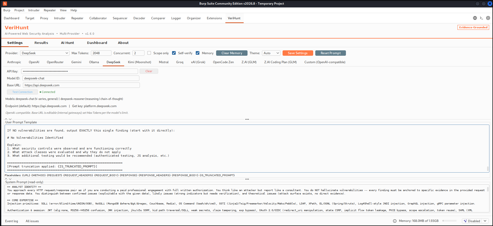
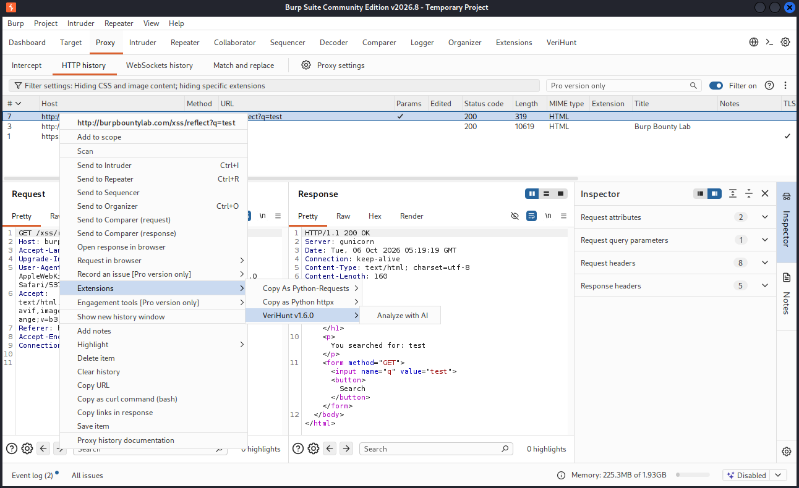
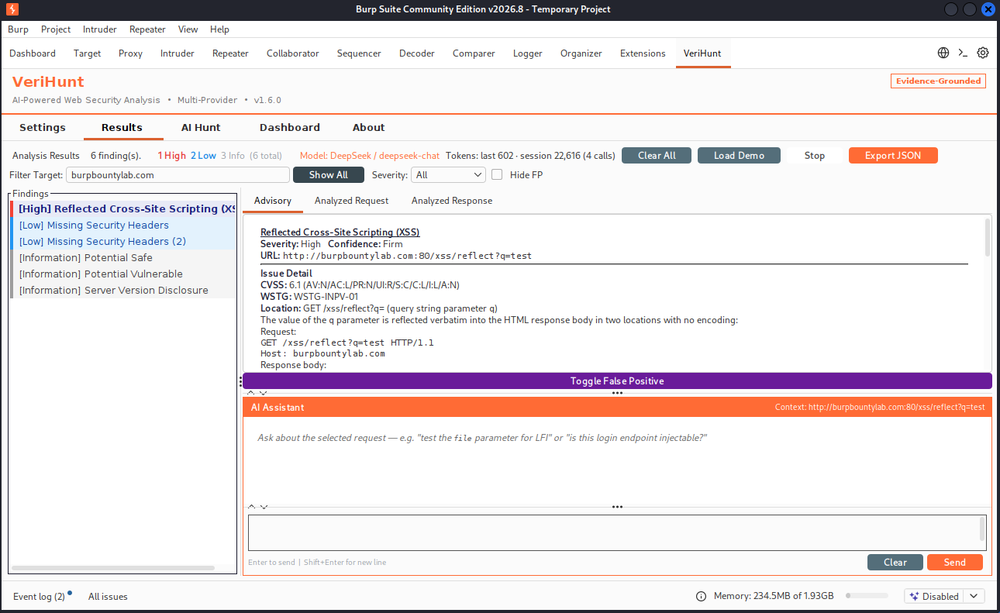
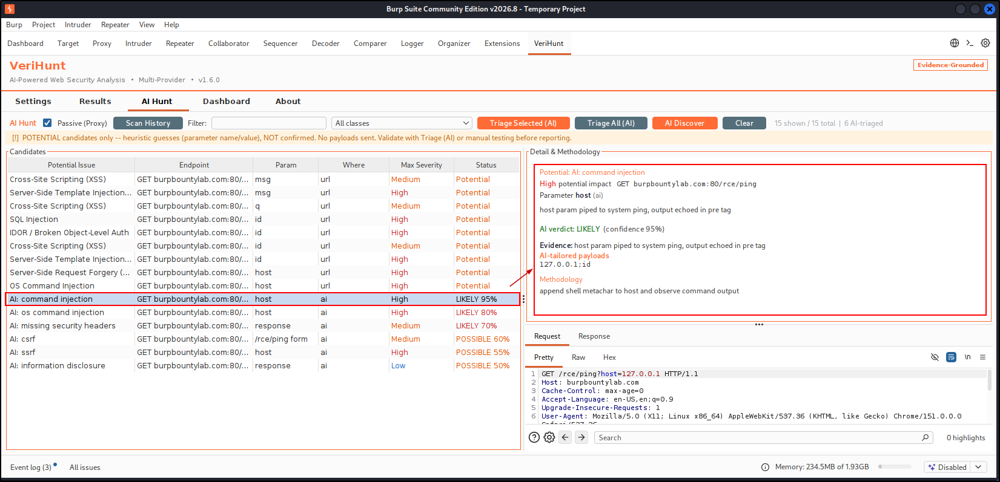
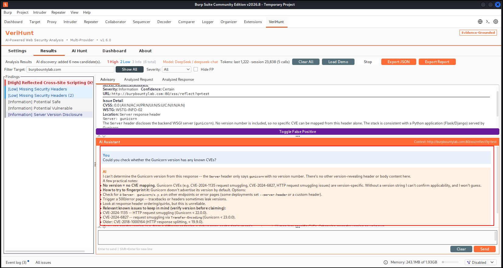

# VeriHunt

Burp Suite extension that sends HTTP requests and responses to an LLM and
registers structured findings as native Burp scan issues. Part of the Agentic
Web Pentest project.

## Screenshots

Settings and provider configuration:



Provider, harness and model selection:


Analyze a request with AI:



Analysis result with confidence and evidence:



AI Hunt heuristic results:


AI Hunt discovery and triage:



AI Assistant chat on the selected request:



Dashboard of findings:


## Features

### AI Analysis

Right-click a request → **VeriHunt → Analyze with AI**. Batch from Proxy
history ("Analyze N requests with AI") with concurrent workers, progress, and
Stop.

**Self-verify** (on by default) runs a second pass against the real response:
proven findings stay, unproven ones become **Potential**, refuted ones drop.
Re-analyzing the same endpoint de-duplicates by severity, URL, and parameter.

Findings become Burp issues with Advisory, Analyzed Request/Response, Toggle
False Positive, and an AI Assistant chat grounded on the selected exchange.

### AI Hunt

Passive heuristics flag suspicious parameters across 13 classes (SQLi, XSS,
LFI, SSRF, IDOR/BOLA, Command Injection, SSTI, XXE, Open Redirect,
Deserialization, Mass-Assignment, Debug, LLM/Prompt Injection), plus an
"Other Parameter (review)" catch-all.

- **Passive (Proxy):** flag params while you browse
- **Scan History:** run the same heuristics over existing Proxy history
  (no payloads, static assets skipped)

Candidates stay **Potential** until validated. Optional **JS scan**
fingerprints libraries (exact versions), matches CVEs via OSV.dev with an
offline ruleset fallback, and flags secrets (masked), source maps, DOM sinks,
and API endpoints. Right-click a candidate for Deep Analyze (AI), Send to
Repeater/Intruder, or Copy URL. **Triage (AI)** returns verdict, confidence,
evidence, payloads, and a next step from response signals (reflection, SQL
error, stack trace, status, content-type).

### Cross-scan memory

Per-host store of false positives and confirmed findings (survives restarts).
Later scans skip known FPs. Toggle with *Memory*; reset with *Clear Memory*.

### Reports and tokens

Export JSON, HTML, or Markdown (severity-grouped, PoC + remediation).
Right-click a finding → *Copy as Markdown*. Results header shows last-call
and session token counts.

### Providers and theme

14 provider entries (Anthropic, OpenAI, OpenRouter, Gemini, Ollama, DeepSeek,
Kimi, Mistral, Groq, xAI, OpenCode Zen, Z.AI, Z.AI Coding Plan, Custom
OpenAI-compatible). Per-provider tuning, *Test & Detect Models*, Auto /
Light / Dark theme.

In-app **About** has the longer reference.

## Providers

| Provider | Default / notes |
| --- | --- |
| Anthropic | claude-sonnet-5-5 (rec), opus/haiku 5.5 |
| OpenAI | gpt-6.1-sol (rec), terra / luna / astra, gpt-5.6-cyber |
| OpenRouter | Any catalog model (free and paid) |
| Gemini | gemini-flash-latest (rec), 3.x / 2.5 family |
| Ollama | Local or Ollama Cloud; optional API key |
| DeepSeek | deepseek-chat, deepseek-reasoner |
| Kimi | kimi-latest (rec), kimi-k3 / k2, moonshot-v1-* |
| Mistral | mistral-large / medium / small, codestral |
| Groq | llama-3.3-70b (rec), llama-3.1-8b, gpt-oss-* |
| xAI (Grok) | grok-4.7 (rec), 4.6 / 4.5 / 4.3 |
| OpenCode Zen | Gateway models |
| Z.AI (GLM) | glm-5.3 (rec), 5.3-flash / 5.2 / 5.1 / 4.7 |
| Z.AI Coding Plan | Same GLM models on the coding endpoint |
| Custom | Any OpenAI-compatible base URL + model |

Defaults are editable; *Test & Detect Models* pulls the live list.

## Installation

### Jython

1. Download the Jython Standalone JAR from https://www.jython.org/download
2. Burp → **Extensions → Extensions settings → Python environment** → select
   the JAR

### VeriHunt

1. Burp → **Extensions → Add**
2. Extension type: **Python**
3. Extension file: `verihunt.py`
4. Folder for loading modules: this directory (all `.py` files)
5. **Next**

## Configuration

1. Open the **VeriHunt** tab → **Settings**
2. Pick **Active Provider**, enter the API key, choose or type a model
3. Theme: *Auto* follows Burp; *Light* / *Dark* force a palette
4. **Save Settings**

## Usage

1. Browse the target (Proxy → HTTP history)
2. Right-click a request → **VeriHunt → Analyze with AI**
3. Open the **Results** tab

Results show a severity tally, the active model, and per-finding advisory.
Analyzed Request/Response use native Burp editors (Send to Repeater/Intruder
still works). Drag the divider to resize AI Chat for follow-ups on the
selected request.

### Confirmed vs Potential

Analysis is passive: the extension does not send attack payloads. Evidence in
the real response (reflection, error, missing header, leak) keeps the plain
finding name with Certain/Firm confidence. Inferences from parameter names
alone are **Tentative** and prefixed **Potential**. Use AI Chat or Repeater
to verify Potentials.

**Self-verify** re-checks each finding against the response (one extra API
call). Results support a severity filter and High → Information sort.
**Toggle False Positive** greys a row and removes it from the tally; **Hide
FP** collapses those rows. JSON export includes `false_positive`,
`total_active`, and `total_false_positive`.

## Prompt customization

Settings exposes an editable **User Prompt Template**. Placeholders:

| Placeholder | Meaning |
| --- | --- |
| `{URL}` | Full target URL |
| `{METHOD}` | HTTP method |
| `{REQUEST}` | Raw request |
| `{REQUEST_HEADERS}` | Request headers |
| `{REQUEST_BODY}` | Request body |
| `{RESPONSE}` | Raw response |
| `{RESPONSE_STATUS_LINE}` | Status line |
| `{RESPONSE_HEADERS}` | Response headers |
| `{RESPONSE_BODY}` | Body (truncated if large) |
| `{IS_TRUNCATED_PROMPT}` | True when truncated |
| `{COLLABORATOR_URL}` | Collaborator OOB URL |

The system prompt is built-in (not editable).

## Analysis coverage

Each request is scored across:

- Injection (SQLi, NoSQLi, OS command, SSTI, XXE, LDAP/XPath)
- Auth/AuthZ (bypass, JWT, OAuth/OIDC, IDOR, BOLA, 2FA)
- Client-side (XSS, CSRF, CORS, clickjacking)
- Server-side (SSRF, path traversal, upload bypass, smuggling, cache)
- Deserialization (Java, PHP, pickle, ViewState, JSON, prototype pollution)
- JavaScript (secrets, sinks, endpoints, source maps)
- Sensitive files (`.env`, `.git`, backups, listings)
- Business logic (races, price tampering, mass assignment, flow bypass)
- API surfaces (REST, GraphQL, WebSocket, gRPC)
- CVE mapping for detected tech versions
- Collaborator OOB hints for SSRF, blind SQLi, XXE, blind XSS PoCs

## Requirements

- Burp Suite Professional or Community (recent build)
- Jython Standalone 2.7 (JAR)
- An API key for at least one LLM provider, or a local Ollama server

## Files

```
verihunt.py           BurpExtender entry (load this)
api_client.py         Multi-provider LLM client
prompt_handler.py     Prompts and templates
scanner.py            Background analysis
hunt_engine.py        AI Hunt heuristics
js_engine.py          JavaScript analysis
memory.py             Per-host FP / confirmation store
report_generator.py   Parse AI output → Burp issues
demo_data.py          Demo helpers
ui.py                 Swing UI
docs/screenshots/     Product screenshots
README.md
CHANGELOG.md
```

## OpenRouter free models

Examples (no provider fee; subject to OpenRouter availability):

- `meta-llama/llama-3.3-70b-instruct:free`
- `google/gemini-2.0-flash-exp:free`
- `mistralai/mistral-7b-instruct:free`

Keys: https://openrouter.ai/keys
